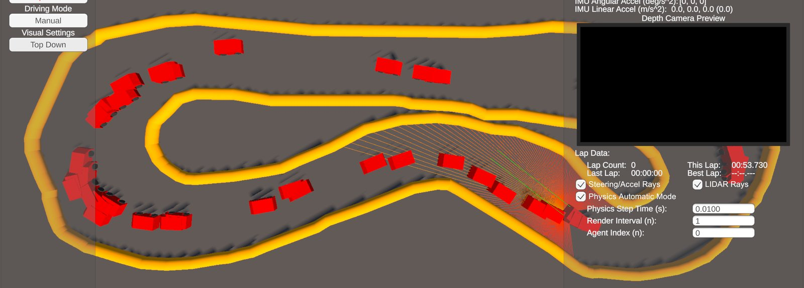

# UCI-F1Tenth-Unity-Simulator-Bridge

A TCP bridge to the simulator, a follow-the-gap controller, and PPO training with
[Stable-Baselines3](https://stable-baselines3.readthedocs.io/) for one car or many cars at once.

This repo is one half of a pair:

- **[UCI-F1Tenth-Unity-Simulator](https://github.com/uci-f1tenth/UCI-F1Tenth-Unity-Simulator)**: the Unity simulator,
  with single-agent and multi-agent scenes. Download it from its
  [Releases](https://github.com/uci-f1tenth/UCI-F1Tenth-Unity-Simulator/releases/latest).
- **UCI-F1Tenth-Unity-Simulator-Bridge** (this repo): the Python side.



## Install

You need Python 3.13 and [uv](https://docs.astral.sh/uv/):

```
git clone https://github.com/uci-f1tenth/UCI-F1Tenth-Unity-Simulator-Bridge.git
cd UCI-F1Tenth-Unity-Simulator-Bridge
uv sync
```

For GPU training, replace the CPU build of PyTorch with a CUDA one from [pytorch.org](https://pytorch.org/get-started/locally/).
Then get the simulator from its [Releases](https://github.com/uci-f1tenth/UCI-F1Tenth-Unity-Simulator/releases/latest).

## Run

Run every script from the repo root. Start the simulator, click **Connect**, then:

| Script | What it does | Scene |
| --- | --- | --- |
| `uv run TraditionalAlgos/FollowTheGap.py` | Drives toward the widest gap in the LiDAR scan. No training needed. | Single agent |
| `uv run SingleAgent/VisualizeBridge.py` | Live plot of the LiDAR scan and telemetry. | Single agent |
| `uv run MultiAgent/MADrive.py` | Drives all cars with the trained model in `models/`. | Multi-agent |
| `uv run MultiAgent/MAVisualizeBridge.py` | Live plot of one car. WASD drives it, up/down switches cars. | Multi-agent |
| `uv run MultiAgent/MATrain.py` | Trains a PPO policy on all cars at once. | Multi-agent |
| `uv run SingleAgent/Train.py` | Trains a PPO policy on one car. | Single agent |
| `uv run SingleAgent/SABenchmark.py`, `MultiAgent/MABenchmark.py` | Measures telemetry updates per second. | Either |

In the single-agent scene, click **Driving Mode** to switch to **Automatic** so Python drives the car.

## Train

Uncheck **Physics Automatic Mode** in the simulator so the physics steps once per command instead of in real time. Then:

```
uv run MultiAgent/MATrain.py --model_path models/my_model
```

Checkpoints are saved to `logs/checkpoints/` and TensorBoard logs to `ma_f110_tensorboard/`
(`uv run tensorboard --logdir ma_f110_tensorboard`). Add `--resume` to continue from a saved model.
Ctrl+C saves the model and its normalization stats (`<model>_vecnorm.pkl`), which `MADrive.py --model_path` loads.

`models/ma_f110_ppo_optimized` was trained for 30M steps with 52 cars. `models/f110_ppo_optimized` is an older
single-agent model from before the current simulator version and crashes on the current track, so it needs retraining.

## Use

To write your own controller, use `UnityTCPBridge` from `SingleAgent/UnityBridge.py`:

```python
from UnityBridge import UnityTCPBridge

bridge = UnityTCPBridge(ip="127.0.0.1", port=5005)
bridge.start()
car = bridge.get_telemetry()        # car.lidarRanges, car.speedMS, car.isCrashed, ...
bridge.send_control(steering, throttle)  # each from -1 to 1
```

The LiDAR has 180 points over 270 degrees, from left to right, in meters (0-20 m).
For many cars, `MATCPTunnel` in `MultiAgent/MAUnityBridge.py` returns arrays with one row per car and takes
`send_action_batch(steering_array, throttle_array)`.
